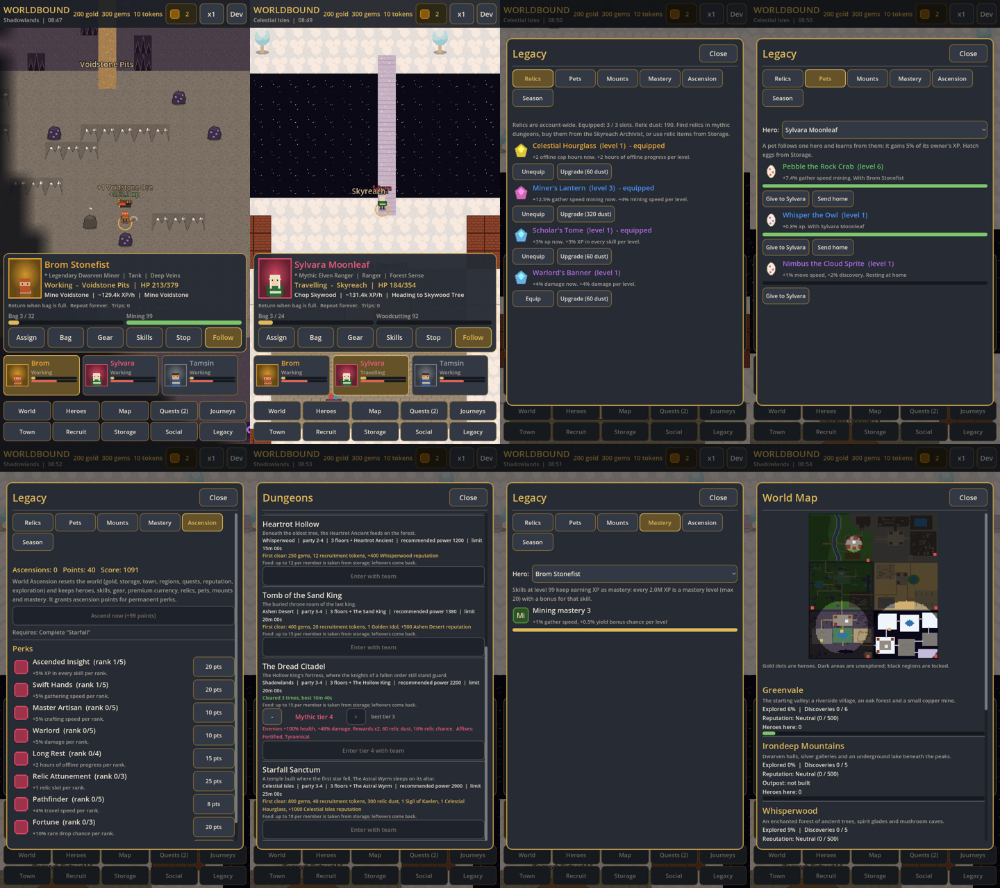
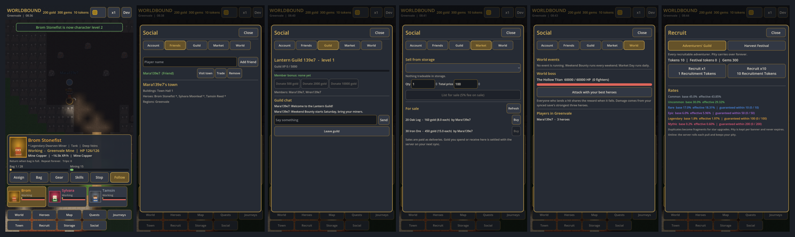
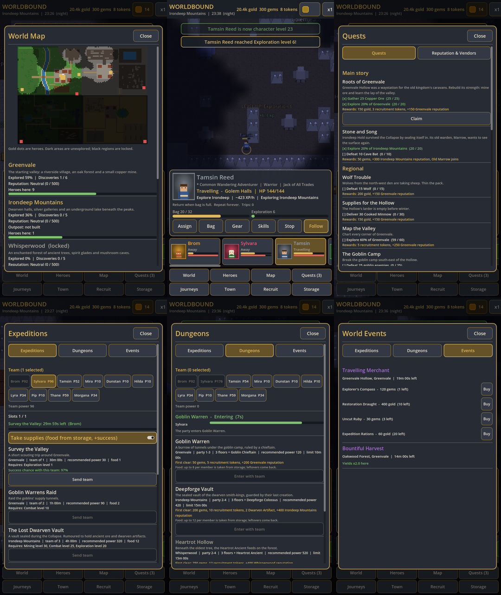
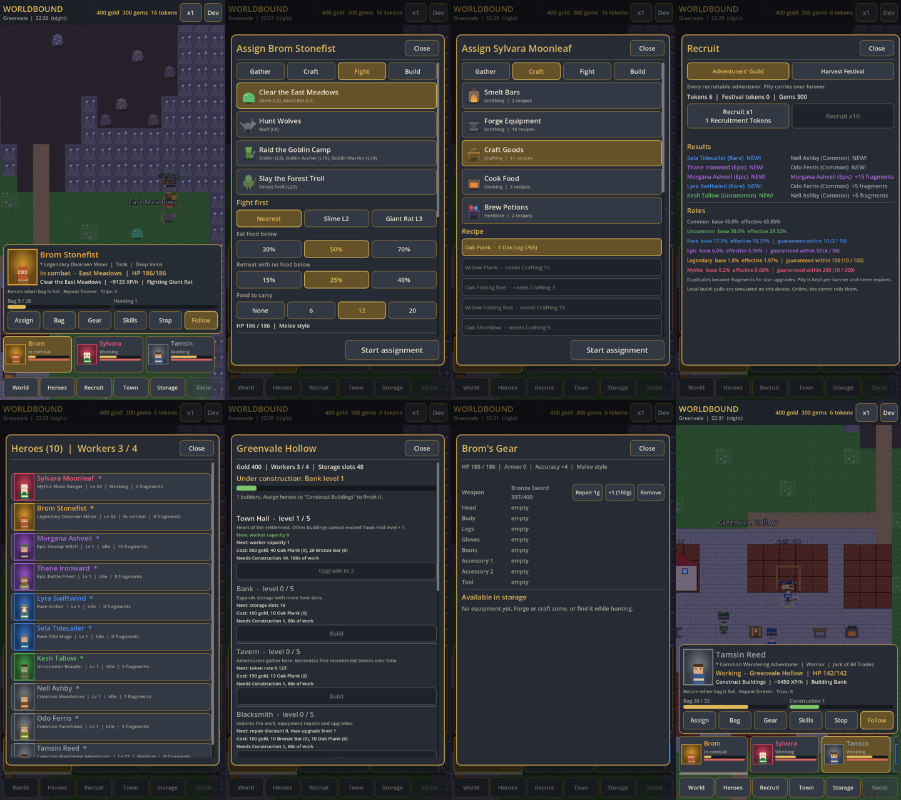
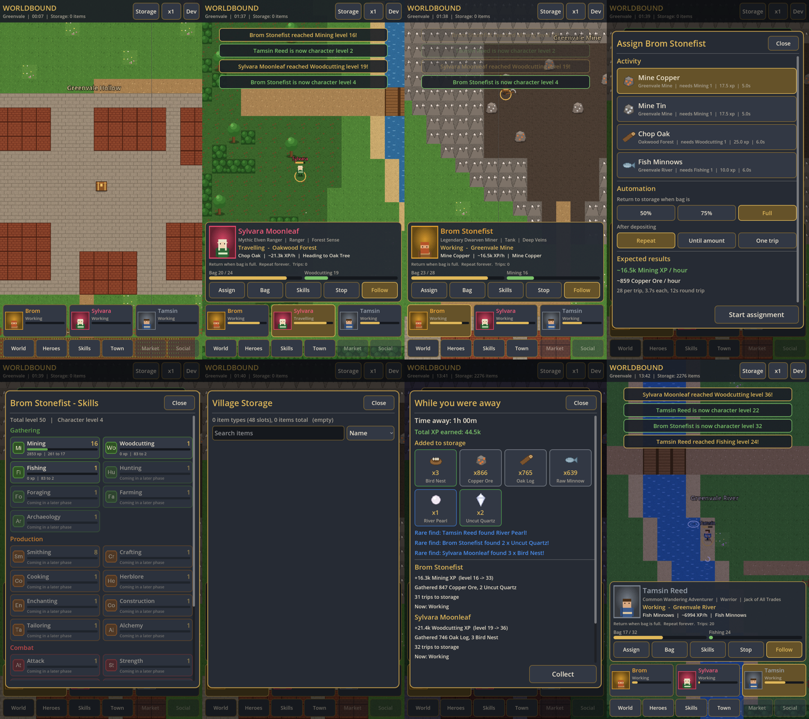

# Worldbound

A 2D open-world idle MMORPG for Android and iOS, built with Godot 4.x and GDScript.
You collect adventurers, give them jobs, and they travel the world on their own to mine, chop,
fish, fight and craft, and they keep working while you are offline. Automation is the
gameplay, not a shortcut around it.

**Current status: all five phases are built.** Phase 5 (endgame) sits on top of Phases 1 to 4.
Online play needs the Nakama server in [server/](server/README.md); without one, the game plays
fully offline. The world simulation still runs on the device, and the server validates it (see
the roadmap's known gaps). Balance is first-pass and the art is placeholder.
[docs/DEVELOPMENT_ROADMAP.md](docs/DEVELOPMENT_ROADMAP.md) lists what is done, every known gap,
and what comes next.



<details><summary>Phase 4 screenshots</summary>


</details>

<details><summary>Phase 3 screenshots</summary>


</details>

<details><summary>Phase 2 screenshots</summary>


</details>

<details><summary>Phase 1 screenshots</summary>


</details>

## What works today

- Greenvale, a 64x48 tile starter region: a village with a storage chest, the Oakwood Forest, the
  Greenvale Mine and the Greenvale River, with walkable and blocked terrain, roads and a bridge.
- Three starter characters, each with their own data, portrait, sprite sheet, skills and bag size:
  - Brom Stonefist (Legendary dwarven miner)
  - Sylvara Moonleaf (Mythic elven ranger who specialises in woodcutting)
  - Tamsin Reed (Common general adventurer)
- Four gathering activities: Mine Copper, Mine Tin, Chop Oak and Fish Minnows.
- An autonomous activity engine with a 14-state machine. Characters pick a free node, path to it
  with A*, gather, gain XP, return to storage when their bag reaches the threshold you set,
  deposit, and resume, all without player input.
- Automation rules: return at 50%, 75% or a full bag; repeat forever, stop after N deposited,
  or make one trip.
- The full 24-skill system with a RuneScape-style XP curve. Mining, Woodcutting and Fishing are
  playable in this phase.
- Character bags, shared village storage (with search and sort), rare drops and level-ups.
- Offline progression: an 8 hour cap and a detailed "While you were away" report. The same
  deterministic simulation runs online and offline.
- Mobile UI: character roster, character panel, assignment builder with XP/hour estimates,
  bag, skills, storage, offline report, toasts and bottom navigation.
- Chunk-based terrain rendering, pooled floating text, a day/night tint, and animated water,
  tools and particles.
- Saves locally with atomic writes. Saves on autosave, on quit and when the app is backgrounded
  on mobile.
- 200 automated tests plus a headless boot smoke test, and 29 more against a live server.

### Added in Phase 2
- **23 adventurers** across six rarities (3 starters, 18 recruitable, 1 quest, 1 exploration),
  each with affinities, a passive, three traits unlocked at character levels 10/30/60, star
  ranks and specializations (chosen at skill level 30).
- **Currencies**: gold, gems, recruitment tokens, festival tokens (plus guild coins, ascension
  points and relic dust reserved for later phases), with an atomic transaction log.
- **Recruitment**: two banners with published base and effective rates, per-banner pity
  (rare in 10, epic in 50, legendary in 100, mythic in 200), a featured character, 10-pull
  discount, duplicates into fragments, and star-up. Local rolls are dev-only; the server will
  own them in Phase 4.
- **Crafting**: 34 recipes at 5 stations (furnace, anvil, workbench, cooking range, alchemy
  table). Characters restock materials from storage, craft, deposit, and wait when materials run
  out. Preserve, double-craft and burn chances.
- **Equipment**: 9 slots, 27 items (tools, weapons, armour, accessories), requirements,
  durability, breaking, repair with gold, upgrades to +5 gated by the Blacksmith.
- **Combat**: 7 enemy types in 4 hunting grounds with rare variants (Champion to Legendary),
  melee/ranged/magic styles, food and healing thresholds, retreat rules, injury and resting,
  loot, gold and XP for attack/strength/ranged/magic/defense/hunting.
- **Town**: 12 buildings with 5 levels, construction projects worked by the Construct activity,
  worker capacity, storage slots, tavern tokens, and account-wide bonuses.
- **Gathering expansion**: iron, willow, trout, herbs, potatoes and marrentill.
- **Route builder**: chain steps (for example mine copper, mine tin, smelt bronze) and loop
  them; save routes as templates.
- **NPC shop**: sell from storage, lock and favourite items.
- An item conservation ledger (sources minus sinks) that the tests check across every system.

### Added in Phase 3
- **One 128x96 world with four regions**: Greenvale, the Irondeep Mountains, Whisperwood and the
  Ashen Desert. Regions unlock through quests, skill levels, exploration and gold; gates between
  them open once both sides are unlocked. Two secret passages open through discoveries.
- **Fog of war and exploration**: walking lifts a narrow line of sight; the Explore activity walks
  to the unknown and surveys it (Exploration level and gear make surveys faster and wider).
  20 authored discoveries, some needing a specialty (assassin, mage) or an affinity.
- **Hierarchical navigation**: characters route region to region through gates and fast-travel
  between waystones (home storage and built outposts).
- **Outposts** in the three new regions: a storage depot (characters deposit there instead of
  walking home), crafting stations, a waystone and local gathering bonuses.
- **Quests and reputation**: 8 main story quests, 16 regional quests, 13 repeatable contracts;
  reputation tiers (Neutral to Exalted) per region unlock vendor stock, recipes and a character.
- **Dungeons** (4) with floors, bosses with phases, abilities, summons and enrage, character
  active abilities, a food pool and a time limit. Parties leave the map while inside.
- **Expeditions** (7): long timed journeys with team requirements, success odds from team power
  and supplies, optional stages, random events and injuries, resolved deterministically.
- **Dynamic encounters**: treasure goblins, bountiful harvests, travelling merchants, monster
  surges and wandering heroes who join you, also during offline time.
- **Notifications**: an in-game inbox with per-category switches and merged repeats. Phone
  notifications need a mobile plugin that is not in this build (see known gaps).
- 120 items, 72 recipes, 21 enemy types including 4 bosses, 48 activities, 24 characters.
- New screens: World Map, Quests and Vendors, Journeys (expeditions, dungeons, events) and
  Notifications; a fog overlay, outposts and dungeon entrances on the map.

### Added in Phase 4
- **Online play** through a Nakama server (opt-in in **Social > Account**): device sign-in,
  cloud save with conflict protection, and server checks on every upload.
- **Server-owned** gems and tokens, recruitment rolls and pity.
- **Friends** and **shared towns** (visit a friend's town), **guilds** with levels, member perks
  and realtime chat, a **marketplace** with escrow and a 5% fee, and **private trades**.
- A **co-op world boss** shared by all players, **world events** (Weekend Bounty, Market Day),
  and **player visibility**: other players' heroes in your region appear on the map.

### Added in Phase 5
- **Two endgame regions** below the old map: the **Shadowlands** (blight, a black marsh, the
  Void Rift) and the **Celestial Isles** (floating islands joined by starstone bridges). The
  Celestial Isles open only with a **flying mount**.
- **New content**:
  - voidsteel and starmetal gear, and shadowbark and skywood weapons;
  - 8 new gathering nodes, 6 enemies and 2 bosses;
  - 2 advanced dungeons, 2 expeditions, 4 main quests, 6 regional quests and 4 contracts.
- **Mythic heroes**:
  - Nyx Voidwalker and Kaelen Stormforge come from dungeon sigils.
  - Astraea Skyborn comes from the first World Ascension.
- **Relics** (12): account-wide bonuses in 3 to 6 slots. You level them with relic dust.
- **Pets** (8): each pet follows one hero and levels from 5% of that hero's XP.
- **Mounts** (7): faster travel, plus more carry space or other bonuses.
- **Mastery**: skills at level 99 keep earning XP as mastery levels (up to 20), and each level
  gives a bonus for that skill.
- **Mythic dungeon tiers** 1 to 10:
  - each tier makes enemies tougher;
  - affixes (Fortified, Tyrannical, Frenzied, Famished) start at tier 2;
  - rewards scale, with relic dust and a chance at a relic.
- **World Ascension**: reset the world and keep your heroes and legacy, and earn points for 9
  permanent perks.
- **Seasons** follow the calendar. Each season gives a bonus, festival contracts that pay
  festival tokens, and a Festival Merchant with seasonal stock.
- A **Legacy** screen (new nav button), a mythic tier picker in Journeys, and a **Use** button in
  Storage for eggs, mount whistles, relics and sigils.
- Totals: 190 items, 97 recipes, 29 enemy types including 6 bosses, 64 activities, 27
  characters, 59 quests and 6 regions.

## Running the game

1. Install **Godot 4.3** or newer (the standard build, not .NET).
2. Open `project.godot` in the editor and press **Play** (F5). The game is laid out for portrait
   720x1280, and the desktop window can be resized.
3. Tap or click a character card at the bottom, then **Assign**. Pick a category (Gather, Craft,
   Fight, Build), an activity (and a recipe for crafting), set the automation rules and press
   **Start assignment**. Repeat for the other characters.
4. **Recruit** pulls new adventurers with your 10 starting tokens. **Town** starts construction
   projects; assign heroes to *Construct Buildings* to finish them. **Storage** sells items and
   equips gear on the selected hero. **Gear** on the character panel repairs and upgrades.
5. Drag to pan and pinch or scroll to zoom. **Follow** locks the camera onto the selected character.
6. The top bar's **x1** button changes simulation speed (x1, x5, x20) so you can watch whole loops
   quickly. **Dev** has "simulate time away" buttons for testing offline progression, plus Save and
   Reset. Both are offline-only.
7. **Legacy** holds relics, pets, mounts, mastery, World Ascension and the current season. Use
   eggs, mount whistles, relics and sigils from **Storage** first.
8. **Social** is the online hub. To play online, start a server (see
   [server/README.md](server/README.md)) and enter its address in Social > Account.

## Running the tests

```bash
tools/run_tests.sh                 # all tests + headless boot smoke test
tools/run_tests.sh --filter=mining # only tests whose name or file matches
GODOT=/path/to/godot tools/run_tests.sh
```

The run fails if any test fails **or** if any script or engine error is printed. Tests live in
`tests/unit`, `tests/integration` and `tests/simulation` and use a small dependency-free framework
in `tests/framework`.

With a Nakama server running, `server/run_tests.sh` runs the 20 server tests (Node) and the 9
Godot client tests in `tests/online` against it.

Other tools:

```bash
python3 tools/generate_greenvale_map.py      # regenerate + validate the starter map
python3 tools/generate_world_map.py          # compose + validate the 6-region world map (run after the above)
python3 tools/generate_placeholder_art.py    # regenerate placeholder art
godot --headless --path . -s res://tools/balance_report.gd   # gathering, combat, crafting, exploration, expedition, dungeon, mythic and mastery numbers
godot --headless --path . -s res://tools/gacha_report.gd     # base and effective gacha rates
xvfb-run godot --path . --rendering-method gl_compatibility \
  -s res://tools/capture_screenshots.gd -- --out=/tmp/shots  # visual smoke test + screenshots
xvfb-run godot --path . --rendering-method gl_compatibility \
  -s res://tools/capture_endgame_screenshots.gd -- --out=/tmp/shots  # endgame regions and Legacy screen
WB_NAKAMA_URL=http://127.0.0.1:7350 xvfb-run godot --path . --rendering-method gl_compatibility \
  -s res://tools/capture_online_screenshots.gd -- --out=/tmp/shots  # online screens (needs a server)
python3 tools/build_server_module.py         # rebuild server/nakama/modules/index.js
```

## Project layout

```
project.godot          Godot project (main scene: scenes/main/Main.tscn, autoload: Game)
data/                  All balance and content as JSON (skills, items, nodes, activities, characters, map, config)
scripts/core/          Game autoload, DataRegistry, SimulationWorld, StatBlock, AccountEffects, time source
scripts/activities/    ActivityEngine (state machine driver), Assignment, ActivityEstimator,
                       handlers/ (gathering, crafting, combat, construction, exploration)
scripts/characters/    Adventurer (runtime state), CharacterStates, CharacterView
scripts/pathfinding/   GridPathfinder (A* on AStarGrid2D, cached), PathResult, RegionNavigator (gates, waystones)
scripts/world/         WorldGrid, ResourceNodeState, ExplorationState (fog, discoveries), EncounterDirector,
                       chunk renderer, fog overlay, camera, views, day/night
scripts/skills/        XpTable, SkillSet
scripts/inventory/     Inventory (bags and storage)
scripts/progression/   Offline progression interface, local simulator, offline report, Objectives (conditions)
scripts/combat/        EnemyState, CombatRules, DungeonRun (party vs floors and boss)
scripts/quests/        QuestState (quests, contracts, reputation)
scripts/expeditions/   ExpeditionState (slots, odds, deterministic resolution)
scripts/notifications/ NotificationCenter (inbox), LocalNotifier (OS bridge, needs a plugin)
scripts/endgame/       EndgameState (relics, pets, mounts, mastery, ascension perks, mythic records, seasons)
scripts/economy/       Wallet
scripts/equipment/     EquipmentService (equip, wear, repair, upgrade)
scripts/recruitment/   RecruitmentState (rolls, pity, effective rates)
scripts/town/          TownState (buildings, construction projects)
scripts/multiplayer/   GameBackend + LocalGameBackend, NakamaGameBackend, NakamaClient/Socket, OnlineService, OnlineSync
scripts/save/          SaveService
scripts/ui/            HUD, panels, theme, pooled floating text
scenes/                Main, WorldView, HUD scenes
assets/                Placeholder art at final-art paths (see asset pipeline in docs)
tests/                 Unit, integration, simulation and online (live server) tests + runner
server/                Nakama module (src, built module), server tests, run scripts (see server/README.md)
tools/                 Map/art generators, test runner script, balance report, screenshot capture
docs/                  Design, architecture, roadmap, systems, data schema, balance, changelog
```

Some folders (for example `assets/audio` and `scenes/combat`) carry a README that describes
what goes there.

## Documentation

| Document | Contents |
|---|---|
| [GAME_DESIGN.md](docs/GAME_DESIGN.md) | Vision, pillars, core loop, world, characters, all planned systems |
| [TECHNICAL_ARCHITECTURE.md](docs/TECHNICAL_ARCHITECTURE.md) | Layers, simulation model, backend plan, asset pipeline, coding conventions |
| [DEVELOPMENT_ROADMAP.md](docs/DEVELOPMENT_ROADMAP.md) | Phases 1-5, the running implementation checklist |
| [SYSTEMS.md](docs/SYSTEMS.md) | How each implemented system works and how to test it |
| [DATA_SCHEMA.md](docs/DATA_SCHEMA.md) | Every data file's schema, the save format, server storage |
| [server/README.md](server/README.md) | Running the Nakama server, what it owns, its limits |
| [BALANCE.md](docs/BALANCE.md) | XP curve, gathering rates, offline caps, planned gacha rates |
| [CHANGELOG.md](docs/CHANGELOG.md) | Version history |

## Platform notes

The project uses the Mobile renderer, portrait orientation and touch input, with mouse input
emulated as touch on desktop. Android and iOS export presets are not committed yet, because they
need your signing keys and bundle IDs. See "Mobile export" in
[TECHNICAL_ARCHITECTURE.md](docs/TECHNICAL_ARCHITECTURE.md#mobile-export).
